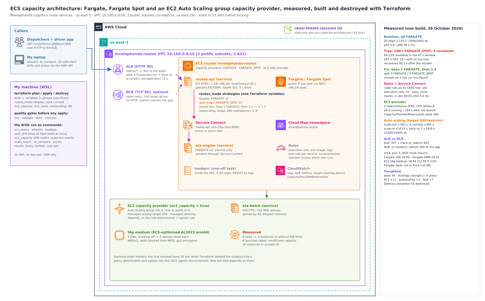

# ECS capacity architecture: Fargate, Fargate Spot and EC2 capacity providers, measured

I built a two-service container platform on **Amazon ECS** for a route-optimisation workload, then measured the capacity choices that matter:

- what happens when everything runs on **Fargate Spot** and all of it is reclaimed at once;
- how **base + weight** capacity provider strategies split tasks;
- how an **EC2 Auto Scaling group capacity provider** scales from zero, and what really limits how many tasks fit on an instance;
- how **service auto scaling** reacts to load;
- what each option costs per 1,000 task-hours, from AWS's own price list.

Everything is declared in **Terraform** and was built, measured and destroyed in one day.



## The scenario: Mvelaphanda's route services

Mvelaphanda Logistics (a fictional South African logistics company) runs route optimisation for its dispatchers and drivers. There are two services:
- `routes-api`, behind a load balancer, which the dispatch console and the driver app call;
- `eta-engine`, an internal service that `routes-api` calls for every route.

A third workload, `eta-batch`, recomputes routes at night.

Everything ran on on-demand capacity. Finance wanted Spot prices; operations feared interruptions in the middle of a dispatch shift.

**What I set out to answer, with measurements:**
- What does a dispatcher see if every `routes-api` task is on Fargate Spot and Spot takes them all back at once? And how do I configure the fix?
- Fargate or EC2 for the batch work: what does each cost per 1,000 task-hours, and what really decides how many tasks fit on an instance?
- How fast does the service scale out under a load step, and back in afterwards?
- Do the services run with the right IAM role (task role, not execution role)? Does service-to-service discovery work without hard-coded addresses?

## Results

All numbers come from one build on 26 October 2026:
- [`docs/results/summary.txt`](docs/results/summary.txt), with the raw files in [`docs/results/raw/`](docs/results/raw/);
- 28 screenshots ([index](docs/screenshots.md)).

Times are UTC.

| What I measured | Result |
|---|---|
| Baseline: 20 requests/s for 120 s, all on Fargate | **2400/2400 OK**, p50 5.6 ms, p99 29.1 ms |
| **The trap:** `routes-api` 100% Fargate Spot, all 4 tasks reclaimed at once while traffic runs | **69.23% available** in the 97 s reclaim window (1343/1940 OK, 597 × HTTP 503). The longest stretch with no successful request was **28 s**. Recovered (4/4 running and healthy) **95.1 s** after the reclaim. |
| The fix: base 2 on FARGATE, then FARGATE:FARGATE_SPOT 1:3, 6 tasks | Split verified: **3 FARGATE / 3 FARGATE_SPOT**, 6/6 healthy. **I didn't run the reclaim drill on this configuration**, so I don't have an availability figure for it ([why that matters](docs/capacity-providers.md)). |
| EC2 density: t4g.medium, `awsvpc` tasks of 0.25 vCPU / 512 MiB | **2 tasks per instance, limited by network interfaces** (3 ENIs minus the instance's own). CPU would allow 8 and memory about 7. 6 tasks needed **3 instances instead of 1**. |
| EC2 scale-out | 6 launch attempts failed for insufficient capacity, 5 of them before the third instance started. Every instance that did start landed in **us-east-1b**. All 6 tasks were running **about 164 s** after the first instance launched. |
| Service auto scaling, target 300 requests per task per minute, min 2, max 6 | First scale-out **292 s** after the load step to 50 requests/s; 6 tasks running at **365 s**. Scale-in began **1015 s** after the load ended, one task every 2 minutes, back to 2 at **1409 s**. **21600/21600 OK** throughout. |
| Task role vs execution role | Both services' code runs as **their own task role**, never the execution role. No credentials appear in any response. |
| Service Connect | `routes-api` → `eta-engine` by name: **20/20 OK**, p50 **3.4 ms**, both `eta-engine` tasks used |
| ALB vs NLB in front of the same service | **ALB:** adds `X-Forwarded-For` and a trace ID, and blocks `/admin/*` with a 403 at the load balancer. **NLB:** passes TCP straight through (no forwarded headers, so `/admin` reaches the app: 404). Both 20/20. |
| Cost per 1,000 task-hours (0.5 vCPU / 1 GB, us-east-1 list prices) | **Fargate x86 US$24.69**, Fargate ARM US$19.75, EC2 t4g.medium **US$18.44** at the 2-tasks-per-instance limit (US$12.30 if 3 fitted). Fargate Spot isn't in the Price List API. |
| Terraform | Base `34 added` (state 36). Each strategy change was `1 to change` in place. EC2 capacity `11 added`. Auto scaling `2 added`. NLB `7 added`. **`Destroy complete! Resources: 43 destroyed.`**, clean check empty. |

**The trap, second by second** ([details](docs/capacity-providers.md)):

| Seconds after the reclaim | What the load generator and ECS showed |
|---|---|
| 0 (10:34:58.538) | I stop all 4 FARGATE_SPOT tasks at once. ECS moves them to `DEACTIVATING` and deregisters them from the target group, then sends SIGTERM. That's the same shutdown a Spot interruption ends with, minus the two-minute warning. |
| 0–31 | Still 100% OK. The stopping tasks were in `DEACTIVATING` and still answering; at +19 s all 4 targets were still listed healthy. |
| 32–62 | **597 × 503** from the ALB. 31 seconds had errors, 28 of them in a row with no successful request at all. |
| 64 | 4 replacement tasks still pending, 1 target healthy |
| 95.1 | 4/4 running, every target healthy |

## How it works

- **The cluster has three capacity providers:**
  - `FARGATE`;
  - `FARGATE_SPOT`;
  - an EC2 Auto Scaling group provider: ECS-optimised Amazon Linux 2023 on Graviton t4g.medium, managed scaling at target 100%, managed draining, starting at 0 instances.
- **Each service picks its capacity through a strategy** set by one Terraform variable, `routes_mode`:
  - `fargate`: all on-demand;
  - `spot`: the trap;
  - `mixed`: the fix, base 2 on FARGATE then weight 1:3 with FARGATE_SPOT.
- **No container image to build.**
  - Every service uses the public `python:3.12-slim` image, with its code passed in as a base64 environment variable.
  - The code is in [`app/`](app/) and uses only the standard library.
  - Each service reports its task, AZ and launch type from the ECS task metadata endpoint, and `/whoami` reports the role ARN it actually runs as.
- **Graceful shutdown:**
  - on SIGTERM a task fails its health check, keeps serving for 5 s, then stops accepting connections;
  - `stopTimeout` is 30 s;
  - the target group deregistration delay is 15 s.
- **Service Connect** (Cloud Map namespace `mvelaphanda-routes`): `routes-api` calls `http://eta:8080` through the Service Connect proxy.
- **The load generator runs inside AWS** as a one-off Fargate task, so my home connection doesn't distort the results.
- **The scripts in [`scripts/`](scripts/):**

  | Script | What it does |
  |---|---|
  | `ecs_status.py` | Cluster status, waiting until it's stable |
  | `whoami.py` | Checks the roles, Service Connect and ALB rules |
  | `loadgen.py` | Starts the in-VPC load generator and collects its results |
  | `spot_drill.py` | The reclaim drill |
  | `ec2_capacity.py` | ENI maths, the scale-out watch, interfaces per instance |
  | `scale_watch.py` | Watches auto scaling under load |
  | `lb_compare.py` | Compares the ALB and NLB in front of the same service |
  | `prices.py` | Cost per 1,000 task-hours from the Price List API |
  | `results.py` | Collects every measured number into one summary |

More detail:
- [capacity providers, the trap and the fix](docs/capacity-providers.md)
- [EC2 capacity and the ENI limit](docs/ec2-capacity.md)
- [auto scaling](docs/auto-scaling.md)
- [roles and Service Connect](docs/roles-and-service-connect.md)
- [ALB vs NLB](docs/alb-vs-nlb.md)
- [cost](docs/cost-model.md)
- [Terraform](docs/terraform.md)
- [debugging journey](docs/debugging-journey.md)
- [teardown](docs/teardown.md)
- [decisions (ADRs)](docs/adr/)

## Why Terraform

I used to build environments like this with long chains of AWS CLI commands: create, capture an ID, feed it into the next command, then do it all again in reverse to tear down. That was slow and repetitive, and a forgotten delete meant a surprise on the bill.

Here, every drill is one variable in `infra/phases.auto.tfvars`:
- `routes_mode = "spot"`;
- `ec2_capacity = true`;
- `autoscaling = true`;
- `nlb = true`.

Each one turns into a reviewed plan, and the whole project is one `terraform destroy`. State lives in a shared S3 bucket with S3-native locking.

## What went wrong, and what I changed

The full story is in [docs/debugging-journey.md](docs/debugging-journey.md).

- **Removing the EC2 capacity hung for 20 minutes, then timed out.**
  - The apply log shows the cause. Nothing in my configuration depended on the instance role's policy attachments, or on the instances' outbound security group rule. So Terraform deleted them **in the first seconds**, in parallel with the service.
  - The ECS agents lost both their permissions and their route to ECS (`agentConnected False` on all 4 instances), so they couldn't stop their tasks. The service sat in `DRAINING`, with the group already at its maximum of 4 instances.
  - I recovered by force-deregistering the container instances and force-deleting the Auto Scaling group, then letting Terraform finish.
  - The fix in code: the Auto Scaling group now `depends_on` both attachments and the egress rule, so they're removed last.
- **The capacity provider would have refused to delete while still attached to the cluster.** A review before the build caught this. `create_before_destroy` on the capacity provider makes Terraform detach it first, and the recovery apply shows exactly that order.
- **A Ctrl+C during an apply left a stale state lock,** and re-running my `echo` put the same setting into the tfvars file twice. I removed the duplicate, then confirmed no Terraform process was running before `force-unlock`.
- **The EC2 scale-out didn't go to plan.** I expected tasks split 4/2 across two AZs. AWS returned "insufficient capacity" six times, and all three instances ended up in one AZ. I report it as measured.

## Compliance and frameworks

| Framework | What applies | What I built | Gap I'd close in production |
|---|---|---|---|
| **ISO/IEC 27001:2022** | A.5.15/A.8.2 access control and privileged access, A.8.14 redundancy, A.8.32 change management | A separate task role per service, kept apart from the execution role (proven by `/whoami`); services across two AZs; a resilience drill; every change through reviewed Terraform | HTTPS on the ALB (ACM certificate); VPC flow logs and ALB access logs |
| **NIST SP 800-53 Rev. 5** | AC-6 least privilege, CP-10 recovery, SC-7 boundary protection, CM-2/CM-3 configuration and change control | Tasks reachable only from the ALB and NLB security groups, and from each other (for Service Connect); `/admin/*` blocked at the ALB; IMDS blocked for tasks on EC2; IMDSv2; encrypted volumes | WAF on the public ALB; private subnets with NAT or VPC endpoints instead of public task IPs |
| **POPIA** (South Africa), section 19 | Appropriate technical measures to protect personal information. Route and driver data includes driver locations. | Least-privilege roles, no credentials in responses, no inbound admin ports (SSM only) | TLS end to end, log retention and encryption with KMS (checkov flagged both) |

## Repo layout

```
app/              routes_api.py, eta_engine.py, loadgen.py (stdlib only; run inside the public python image)
bootstrap/        the shared Terraform state bucket (one-time)
infra/            network, ALB/NLB, ECS cluster + capacity providers + services, EC2 provider, autoscaling, IAM
scripts/          ecs_status, whoami, loadgen, spot_drill, ec2_capacity, scale_watch, lb_compare, prices, results
docs/             architecture, write-ups, ADRs, results (CSV + raw), screenshots
```

## Reproduce it

From the repo folder, with AWS CLI v2, Terraform 1.11 or newer, Python 3, and an existing state bucket:

```bash
cp env.sh.example env.sh && mkdir -p build/results && source ./env.sh
terraform -chdir=infra init -backend-config="bucket=<your state bucket>"
terraform -chdir=infra apply                                     # 34 resources
python3 scripts/ecs_status.py --wait --label base && python3 scripts/whoami.py
echo 'routes_mode = "spot"' >> infra/phases.auto.tfvars && echo 'routes_desired = 4' >> infra/phases.auto.tfvars
terraform -chdir=infra apply && python3 scripts/spot_drill.py --label trap
terraform -chdir=infra destroy
```

It costs a few dollars for a full day of drills ([cost model](docs/cost-model.md)). Always destroy afterwards ([teardown and clean check](docs/teardown.md)).

## What I'd tell the next team

- **Never put 100% of a user-facing service on Spot.** A mass reclaim cost about 30 seconds of hard downtime here, even with graceful shutdown. A base on on-demand capacity is cheap insurance, but measure it. I verified the 3/3 split; the reclaim on that configuration is the next measurement to take.
- **On EC2, ENIs decide density before CPU or memory do.** With `awsvpc` tasks and no ENI trunking, a t4g.medium held 2 tasks where its CPU could have held 8. That made EC2 only about 25% cheaper than Fargate per task-hour here, not the 50% that 3 tasks per instance would have given.
- **Spread capacity across instance types, not just AZs.** One instance type in one Region hit insufficient capacity six times in under two minutes.
- **Scale-in is deliberately slow:** about 17 minutes before the first step here. Plan costs on the scaled-out size, not the minimum.
- **Teardown order is part of the design.** Instances being drained still need their permissions and their route to the control plane. If nothing in Terraform says so, the cleanup itself breaks.
